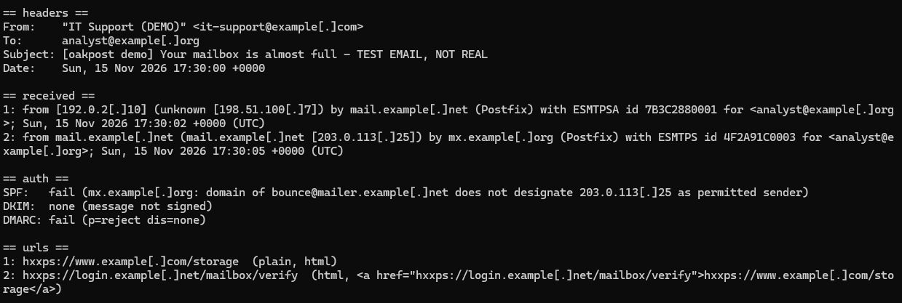
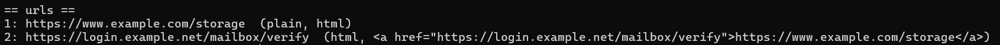
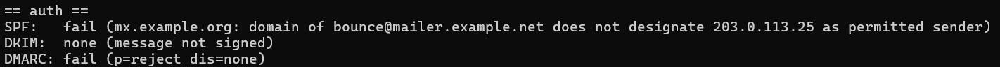
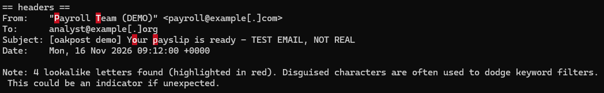

# oakpost

**oakpost** is a command-line tool that pulls the parts of a phishing email that security analysts typically need for initial triage: sender, route, SPF/DKIM/DMARC verdicts and every link out of a raw `.eml` file, so you don't have to search through 200 lines of headers yourself.

It runs locally and only reads the file you give it. Nothing is uploaded anywhere, so it's safe to use on client mail and live phishing samples, but be mindful of the .eml files you download on your machine. **It is highly reccomended to keep the tool in a sandbox/vm.** 



## Built on

- **Python 3**, standard library only — no packages to install.
- Python's built-in [`email`](https://docs.python.org/3/library/email.html) package to read the `.eml`. It handles the encoding emails use (like quoted-printable, where links get split across lines), so oakpost always works on the text as the reader would see it.
- [`re`](https://docs.python.org/3/library/re.html) (regular expressions) to pull out authentication verdicts and links.

## How it works

1. **Load** — oakpost reads the `.eml` file and parses it into a message.
2. **Analyse** — each command is one small function that takes the message and returns its findings. None of them print anything, so each can be tested on its own.
3. **Print** — one output function prints whatever the analysis returned, as a titled section. On the way out it defangs every link, domain and IP, and highlights lookalike characters in colour.

Run it with no command and it runs every analysis. Name a command and you get just that section.

| Command | What it shows |
| --- | --- |
| `headers` | From, To, Subject and Date |
| `received` | The Received chain, oldest hop first, so you can follow the route the mail took |
| `auth` | SPF, DKIM and DMARC verdicts, with the reason the receiving server gave |
| `urls` | Every link in the plain-text and HTML versions, tagged with where it was found. In HTML, a link whose visible text is a different web address is shown in full |
| `--fang` | Not a command: add it to any command to show links live instead of defanged |

## Examples

The examples below use [`examples/demo.eml`](examples/demo.eml), a test email made for this README. It isn't a real phish, and every address in it is a reserved example domain.

Catching a link that pretends to be somewhere else:

```text
$ python oakpost.py urls examples/demo.eml

== urls ==
1: hxxps://www.example[.]com/storage  (plain, html)
2: hxxps://login.example[.]net/mailbox/verify  (html, <a href="hxxps://login.example[.]net/mailbox/verify">hxxps://www.example[.]com/storage</a>)
```



Line 2 is the trick: the reader sees `hxxps://www.example[.]com/storage`, but the link goes to `login.example[.]net`. The plain-text version only has the honest link, so anyone checking that version sees nothing wrong.

Checking authentication on its own:

```bash
python oakpost.py auth examples/demo.eml
```



Everything at once:

```bash
python oakpost.py examples/demo.eml
```

Spotting lookalike letters:

```bash
python oakpost.py headers examples/lookalike-demo.eml
```

[`examples/lookalike-demo.eml`](examples/lookalike-demo.eml) is a second test email. Its sender name and subject swap some letters for lookalikes from other parts of Unicode: a Greek `Τ` and `Ρ`, a Greek `ο`, and a mathematical `𝗉`. They read as normal English, but a filter matching the plain words would miss them. In a terminal, oakpost highlights each one in red, and whenever it finds any it ends with a one-line note saying how many and what they mean.



Showing links live:

```bash
python oakpost.py urls --fang examples/demo.eml
```

`--fang` turns defanging off, for when you need a live link to paste into a tool like urlscan.io or VirusTotal. It works with any command, anywhere in the line, and prints a warning first.

## Defanging

Everything oakpost prints is defanged by default: `https://` becomes `hxxps://`, and the last dot of every domain and IP becomes `[.]`, so `login.example[.]net` and `203.0.113[.]25`. This is the main design decision behind oakpost. A triage tool shouldn't print clickable phishing links, and most email parsers do. Defanging happens in the one output function, so no command can print a live link by accident.

Only the display changes. Every analysis still works on the real email, and `--fang` shows the original links when you ask for them.

## Installation

You need Python 3.8 or later.

```bash
git clone https://github.com/ConnorBaines/oakpost.git
cd oakpost
python oakpost.py examples/demo.eml
```

## Roadmap

- [x] `headers` — the four identity headers
- [x] `received` — the hop chain, oldest first
- [x] `auth` — SPF, DKIM and DMARC verdicts
- [x] Fail cleanly on a missing, unreadable or non-email file
- [x] `urls` — links from both the plain-text and HTML parts
- [x] Defang everything by default (`hxxps://`, `evil[.]com`)
- [x] `--fang` to show links live when you need them
- [x] Highlight lookalike characters in colour
- [ ] `--format markdown` — output that pastes straight into a write-up
- [ ] Tag v0.1.0

## Known limits

- `urls` only reads `href="..."` written with double quotes. That covers almost all real email, but not every possible HTML.
- One file at a time.
- Lookalike highlighting needs a terminal that shows colour. It's switched off when the output is saved to a file or piped into another tool, and when `NO_COLOR` is set.
- Lookalikes are only highlighted when they're styled copies of plain letters, or non-Latin letters inside an otherwise English word. Genuine Greek or Russian text and accented letters (é, ü) are left alone.

## Licence

MIT
